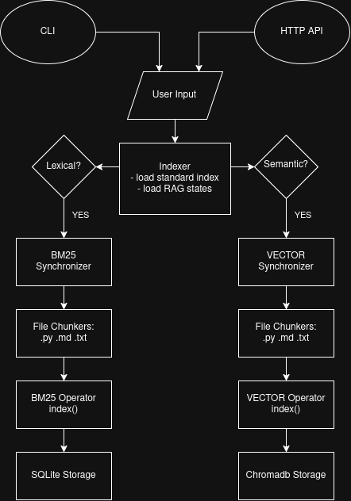
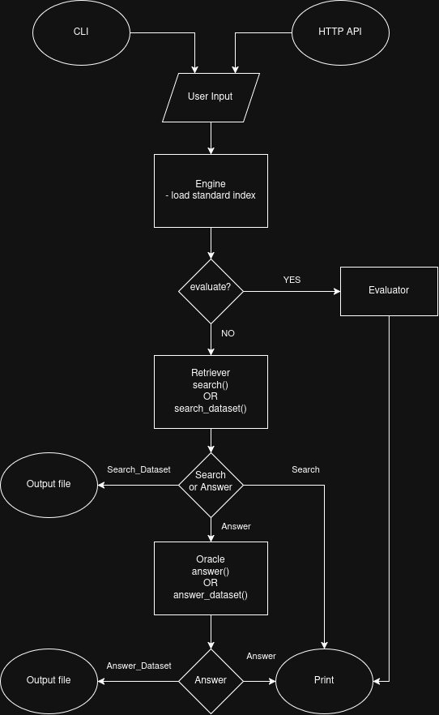

*This project was created as part of the 42 curriculum by kmalfois*

# RAG AGAINST THE MACHINE

-------------------------------------------------------------------------------
# DESCRIPTION

RAG against the Machine is a project that feeds a Language Model with relevant
data from a source and ensures it can operate on that source without
pre-training.

In our specific case, the source is an entire program, and the sLM acts as an
assistant. It can answer questions about Python
(.py), Markdown (.md) and Text (.txt) files.

To achieve that goal, our program pre-processes existing code and
documentation to retrieve the right snippets that allow the Language
Model to formulate a proper response.

Two pipelines are used to recover those snippets. \
The main pipeline performs lexical indexing through a BM25 algorithm managed
by SQLite's FTS5. \
The second pipeline (bonus) performs vector-based semantic indexing using
an embedding model (BAAI/bge-small-en-v1.5 by default), stored in a ChromaDB
collection.

Finally, a Qwen/Qwen3-0.6B model generates answers based on the
recovered snippets.

-------------------------------------------------------------------------------
# INSTRUCTIONS
Use the following commands to install, run, or uninstall RAG against the Machine.

**Installation**
```bash
make install  # creates and sync a virtual environment (venv)
source .venv/bin/activate  # required before lint
```

**Lint check**
```bash
make lint # runs both
make mp  # runs only mypy
make f8  # runs only flake8
make lint-strict  # runs flake8 and strict mypy (optional) 
```

**Clean & Uninstall**
```bash
make clean  # clean off mypy artifacts
make purge  # purge lexical and semantic indexes
make fclean  # runs clean, purge and uninstalls the venv 
```

**Run & Debug**
```bash
make run  # showcase main pipeline (lexical indexing + answer)
make debug  # same action through debug tool
```

-------------------------------------------------------------------------------
# RESOURCES

**Articles**:
- [Qu’est-ce que la RAG (génération à enrichissement contextuel) ?](https://aws.amazon.com/fr/what-is/retrieval-augmented-generation/) - RAG Definition

**Youtube**:
- [BM25 (or Text Search) - The Algorithm that refuses to die](https://www.youtube.com/watch?v=Gk1ovqrbwN4) - BM25 Definition
- [The Easiest Way to Make a Python CLI](https://www.youtube.com/watch?v=R5jeQTFloag) - How to use CLI in python (Fire)
- [RAG Made Simple: ChromaDB + Python (All Local) ](https://www.youtube.com/watch?v=InlB5-3-nR4) - Vector indexing RAG

-------------------------------------------------------------------------------
# SYSTEM ARCHITECTURE

## FILE TREE
```bash
├── assets/  # README.md assets
├── data/  # "data" contains all files related to datasets, generated output, indexes and RAG state.
│   ├── datasets/  # Datasets to exploit.
│   ├── output/  # Script returns.
│   ├── processed/  # Indexes data (standard, sqlite, chromadb)
│   │   ├── lexical/  # BM25 collection
│   │   └── semantic/  # Chromadb collection
│   ├── raw/  # Projects to be processed
│   └── state/  # Lexical and semantic RAG states
├── src/  # Main script location.
│   ├── index/  # Indexing scripts, file chunkers and gatekeeper
│   │   ├── __init__.py  # Module signature
│   │   ├── chunker.py  # Main chunker class
│   │   ├── index_error.py  # Error handler
│   │   ├── indexer.py  # Main indexing script
│   │   ├── md_chunker.py  # Markdown chunker
│   │   ├── py_chunker.py  # Python chunker
│   │   ├── synchronizer.py  # Check added, removed or modified file before indexing
│   │   └── txt_chunker.py  # Text chunker
│   ├── interface/  # Contains all interface elements
│   │   ├── __init__.py  # Module signature
│   │   ├── api.py  # Program HTTP API access
│   │   ├── cli.py  # Program CLI access
│   │   └── interface_error.py  # Error handler
│   ├── lib/  # Libraries and BaseModel contracts
│   │   ├── __init__.py  # Module signature
│   │   ├── contracts.py  # Custom contracts
│   │   ├── data_lib.py  # General libraries
│   │   └── mandatory_contracts  # Subject's mandatory contracts
│   ├── operators/  # BM25 and Vector Operators
│   │   ├── __init__.py  # Module signature
│   │   ├── bm25.py  # BM25 operator [Indexing, research and deletion]
│   │   ├── operator_error.py  # Error handler
│   │   └── vector.py  # Vector operator [Indexing, research and deletion]
│   ├── retrieval/  # Retrieval research and Answer module
│   │   ├── __init__.py  # Module signature
│   │   ├── engine.py  # Main retrieval script
│   │   ├── evaluator.py  # Returns evaluation of results compared to provided ground truth
│   │   ├── oracle.py  # Script in charge of fetching sLM's answer
│   │   ├── retrieval_error.py  # Error handler
│   │   └── retriever.py  # Snippets retriever
│   ├── utils/  # Toolbox
│   │   ├── __init__.py  # Module signature
│   │   ├── bm25_checker.py  # Checks if data is present in BM25 db
│   │   ├── decorators.py  # Custom decorators
│   │   ├── path_finder.py  # Global program path manager
│   │   ├── utils_error.py  # Error handler
│   │   └── vector_checker.py  # Checks if data is present in Chromadb
│   ├── __init__.py  # Main script module signature
│   └── __main__.py  # Main script
├── .flake8  # Flake8 config
├── .gitignore  # Git ignored files
├── .python-version  # Python version
├── Makefile  # Install, uninstall and miscellaneous commands
├── mypy.ini  # Mypy config
├── pyproject.toml  # Project's package handler
├── README.md  # You're HERE :D
└── uv.lock  # Project's locked environment
```

## INDEXER MODULE

<div align="center">



</div>

## RETRIEVAL MODULE

<div align="center">



</div>


-------------------------------------------------------------------------------
# CHUNKING STRATEGY

```bash
uv run python3 src index 2000  # max_chunk_size
```
Chunking happens during indexing and is parameterized by the ```max_chunk_size```
argument. \
Content will be sliced following its respective structure, including preambles,
then re-processed to fit the ```max_chunk_size``` character limit if necessary. \
A '*# Context*' header will also be integrated at the top of every chunk, allowing
Operators to keep the context of a source when searching for the right snippets.

## Python

Python files are sliced using the native Python AST library. \
AST splits classes, methods, and functions to ensure Python code is well
processed by Operators, with help from the contextual header.

## Markdown & Text

Text files are sliced into chunks of predefined character length, while Markdown
files are organized by titles and subtitles according to their '#' based
hierarchy using a custom script.

-------------------------------------------------------------------------------
# RETRIEVAL METHOD

Retrieval is managed by the module of the same name.

## Engine
The Engine is the orchestrator of this module. All entries and commands
are interpreted here to call the right components and answer the user's request.

## Retriever
The Retriever is responsible for recovering relevant snippets.

It takes the user's query and the desired number of sources ```k``` as
arguments to pinpoint the right snippets returned by Operators.\
With the bonus pipeline, retrieval can be based on lexical, semantic, or
hybrid scoring.

## Oracle
Oracle manages the sLM's response to a user query.

The Oracle calls the Retriever to gather the right snippets.\
Once done, it sends a precise prompt to Qwen to ensure a clear and
concise answer based on the provided sources.

## Evaluator
The Evaluator compares the ground-truth JSON provided in the subject
with the result JSON file obtained by a search_dataset or answer_dataset command.\
The evaluation is printed directly in the terminal.

-------------------------------------------------------------------------------
# PERFORMANCE ANALYSIS

Performance is affected by many different parameters.

```recall@k``` and ```max_chunk_size``` both impact the quality of the result. \
Give the sLM too many or too large sources and it might drown in superfluous
context, while the opposite threatens answer integrity if the right
text chunk is not retrieved.

BM25's indexing and retrieval can also be affected by specific element weights.\
Separating context and content and playing with their effective weight
attributions has clearly been decisive in reaching the 80% threshold required
by the subject. \
Removing stop words from the user's query also improved
accuracy.

-------------------------------------------------------------------------------
# DESIGN DECISIONS

## BM25
We chose BestMatch25 over TF-IDF for its superior methodology, and thus
retrieval accuracy. \
The first BM25 engine used was the bm25s library, but after use-case testing,
SQLite's integrated FTS5 proved to be a better and more flexible solution,
especially when it comes to incremental indexing.

## ChromaDB
The best solution for a project of this scale regarding vector based RAG is
ChromaDB for its integrated features. \
At first, the embedding model used was ```all-MiniLM-L6-v2```, as suggested
in the subject, but due to its token limitations, we ended up using
```BAAI/bge-small-en-v1.5```. The result is longer but more accurate indexing.

## FastAPI

```FastAPI``` is our solution of choice for the bonus HTTP API interface. \
It can be launched using ```uv run python3 src serve``` and by visiting
```http://127.0.0.1:8000/docs``` in your web browser. \
It is then possible to test all commands from the generated Swagger UI.

## Incremental Indexing

This feature is managed by the Synchronizer of the index module. \
Consulting RAG_state files in the ```data/state``` folder, this script acts as
a gatekeeper, asserting which files have been added, modified, or removed from a
project.


-------------------------------------------------------------------------------
# CHALLENGES FACED

The real challenge of this project came from the **80% document retrieval score**. \
Finding solutions to score those last points and reach the demanded threshold
was tedious but also both fun and interesting.\
Discovering and understanding the various methods used in RAG to enhance
accuracy was the most rewarding part.
accuracy


-------------------------------------------------------------------------------
# EXAMPLE USAGE
The `make run` command gives a solid showcase of the main
pipeline.

```bash
make run
uv run python3 -m src index 2000  # Runs BM25 Lexical indexing
Loading weights: 100%|██████████████████| 199/199 [00:00<00:00, 4566.91it/s]

[PERF] index finished in 0.0000s

uv run python3 -m src answer "What is vLLM?" 5  # Simple answer
Loading weights: 100%|███████████████████| 311/311 [00:02<00:00, 115.42it/s]

[SINGLE ANSWER]
data/raw/vllm-0.10.1/docs/getting_started/installation/cpu.md - [9709 : 9926]
data/raw/vllm-0.10.1/examples/offline_inference/audio_language.py - [0 : 922]
data/raw/vllm-0.10.1/tests/models/multimodal/generation/test_mllama.py - [19708 : 21495]
data/raw/vllm-0.10.1/docs/serving/parallelism_scaling.md - [4679 : 5374]
data/raw/vllm-0.10.1/benchmarks/README.md - [5316 : 6282]

LLM Answer: vLLM is a distributed computing framework used for scaling Python programs, particularly for running tasks across multiple nodes. It leverages Ray as its runtime engine to manage distributed execution and control where tasks are executed.
```

Additionally, here is the list of available CLI commands
```bash
uv run python3 src serve  # Launch HTTP API, browse 127.0.0.1:8000/docs
uv run python3 src evaluate "student_search_results_path" "dataset_path"  # Evaluation

# Lexical BM25 commands
uv run python3 src index max_chunk_size  # indexing
uv run python3 src purge_index  # Purge current lexical BM25 database
uv run python3 src search "query" k  # Simple search
uv run python3 src search_dataset "dataset_path" k "save_directory"  # Dataset search
uv run python3 src answer "query" k  # Simple answer
uv run python3 src search_dataset "student_search_result_path" k "save_directory"  # Dataset answer

# Semantic Vector commands
uv run python3 src index_semantic max_chunk_size
uv run python3 src purge_index_semantic
uv run python3 src search_semantic "query" k
uv run python3 src search_dataset_semantic "dataset_path" k "save_directory"
uv run python3 src answer_semantic "query" k
uv run python3 src search_dataset_semantic "student_search_result_path" k "save_directory"

# Hybrid commands
uv run python3 src index_hybrid max_chunk_size
uv run python3 src purge_index_hybrid
uv run python3 src search_hybrid "query" k
uv run python3 src search_dataset_hybrid "dataset_path" k "save_directory"
uv run python3 src answer_hybrid "query" k
uv run python3 src answer_dataset_hybrid "student_search_result_path" k "save_directory"
```